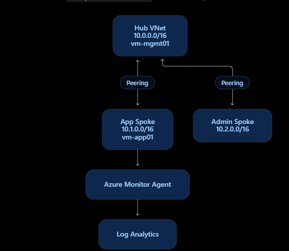

# Azure Hub-and-Spoke Infrastructure with Bicep

A hands-on Azure infrastructure-as-code lab demonstrating private hub-and-spoke networking, network security, Linux virtual machines, centralized monitoring, and a controlled incident-response exercise.


## Project goals

- Provision a hub VNet and two spoke VNets using Bicep.
- Establish private hub-to-spoke connectivity through VNet peering.
- Restrict application VM access using network security groups (NSGs).
- Deploy private Ubuntu VMs without public IP addresses.
- Collect Heartbeat and selected Syslog events using Azure Monitor Agent (AMA), a Data Collection Rule (DCR), and Log Analytics.
- Simulate an SSH outage, investigate the cause, and restore access through IaC.

## Architecture

See [architecture diagram and network details](docs/architecture.md).

| Component | Configuration |
| --- | --- |
| Resource group | `rg-hubspoke-lab` |
| Region | `centralus` |
| Hub VNet | `vnet-hub` — `10.0.0.0/16` |
| Management subnet | `snet-management` — `10.0.1.0/24` |
| Application spoke | `vnet-spoke-app` — `10.1.0.0/16` |
| Application subnet | `snet-app` — `10.1.1.0/24` |
| Admin spoke | `vnet-spoke-admin` — `10.2.0.0/16` |
| Admin subnet | `snet-admin` — `10.2.1.0/24` |
| Management VM | `vm-mgmt01`, private Ubuntu VM in hub |
| Application VM | `vm-app01`, private Ubuntu VM at `10.1.1.4` |
| Monitoring | `law-hubspoke-lab`, `dcr-hubspoke-syslog`, AMA |

The hub is peered bidirectionally with each spoke. **VNet peering is not transitive**: this design does not establish spoke-to-spoke routing automatically.

## Repository structure

```text
.
├── README.md
├── .gitignore
├── infrastructure/
│   ├── main.bicep
│   ├── compute.bicep
│   ├── incident-simulation.bicep
│   └── incident-recovery.bicep
├── monitoring/
│   ├── monitoring.bicep
│   ├── syslog-dcr.bicep
│   ├── dcr-association.bicep
│   └── ama-extension.bicep
├── docs/
│   ├── architecture.md
│   └── troubleshooting.md
└── screenshots/
    └── (validation screenshots)
```



## Deployment approach

The baseline network and compute resources were defined in `infrastructure/main.bicep`, with VM definitions in `compute.bicep`. Monitoring components were deployed using standalone Bicep templates to avoid an unintended change to immutable VM SSH-key settings during a full redeployment. The incident and recovery templates independently update `nsg-app`.

The workflow used throughout the lab was:

1. Save the Bicep source in VS Code.
2. Compile with `az bicep build`.
3. Review `az deployment group what-if`.
4. Deploy with `az deployment group create`.
5. Verify the deployed configuration and test actual behavior.

Example commands (run from the repository root for compilation, then use the generated JSON in Cloud Shell):

```powershell
az bicep build --file ./infrastructure/incident-recovery.bicep

az deployment group what-if `
  --resource-group rg-hubspoke-lab `
  --template-file ./incident-recovery.json

az deployment group create `
  --resource-group rg-hubspoke-lab `
  --template-file ./incident-recovery.json
```

**Reproducibility note:** This is a record of a completed lab, not a guaranteed one-command redeployment. The current templates require a valid SSH public key parameter where applicable; the VM's system-assigned managed identity was enabled manually during troubleshooting and should be incorporated into `compute.bicep` before relying on fully automated monitoring setup.

## Network security and validation

The application NSG (`nsg-app`) was configured to allow TCP/22 from `10.0.1.0/24` at priority 100 and explicitly deny other inbound traffic at priority 200. The explicit deny prevents the default `AllowVNetInBound` rule from allowing broader access than intended.

Validation included:

- Checking VNet peering state and private IP configuration.
- Inspecting effective NSG rules and VM routing.
- Testing TCP/22 from `vm-mgmt01` to `vm-app01` over private networking using Azure VM Run Command.
- Using Network Watcher IP Flow Verify to test allowed SSH and denied HTTPS traffic.

## Monitoring and observability

A Log Analytics workspace (`law-hubspoke-lab`) was deployed with 30-day retention. A Syslog DCR collected `auth`, `authpriv`, and `daemon` facilities at Warning, Error, Critical, Alert, and Emergency severity levels. The DCR was associated with `vm-app01`, and Azure Monitor Agent was installed.

Both **Heartbeat** and **Syslog** ingestion were verified in Log Analytics. A managed identity authentication problem initially prevented ingestion; see [troubleshooting](docs/troubleshooting.md).

Example KQL:

```kusto
Heartbeat
| where TimeGenerated > ago(1h)
| where Computer == "vm-app01"
| order by TimeGenerated desc
```

```kusto
Syslog
| where TimeGenerated > ago(1h)
| where Computer == "vm-app01"
| project TimeGenerated, Facility, SeverityLevel, SyslogMessage
| order by TimeGenerated desc
```

## Controlled incident-response exercise

1. **Baseline:** Verified TCP/22 from `vm-mgmt01` to `vm-app01` was reachable.
2. **Disruption:** Deployed `incident-simulation.bicep`, adding a priority-100 deny rule for SSH from the management subnet and moving the existing SSH allow rule to priority 110.
3. **Impact:** The same TCP/22 test returned `SSH PORT UNREACHABLE`.
4. **Investigation:** Heartbeat and Syslog continued to ingest, supporting that the VM remained operational. Guest Syslog did not contain an SSH-denial record, consistent with traffic being filtered at the NSG before reaching the guest. Network Watcher IP Flow Verify was used as a network-level diagnostic during the project; attach a rule-specific incident result only if captured.
5. **Recovery:** Deployed `incident-recovery.bicep`, removing the temporary deny rule and restoring the SSH allow rule to priority 100.
6. **Validation:** Deployment succeeded and TCP/22 returned `SSH PORT OPEN`.

**Key lesson:** Guest OS logging and Azure network-layer diagnostics answer different questions. An NSG deny does not automatically create a Syslog entry inside the VM.

## Evidence gallery
 Found in screenshot folder.

## Troubleshooting highlights

The project included troubleshooting of NSG rule priority validation, immutable VM SSH-key settings, Azure Monitor managed identity authentication, empty ARM templates caused by unsaved Bicep files, and distinguishing network filtering from guest logging. Full notes:(docs/troubleshooting.md).

## Cost and cleanup

Private VMs and managed disks, Log Analytics ingestion, and other Azure resources may incur charges. VMs were deallocated when not needed. Once evidence was captured, the entire lab resource group was deleted

```powershell
az group delete --name rg-hubspoke-lab --yes
```

**Warning:** This deletes all resources in that group, including stored monitoring data. Verify the resource group contents before running the command.

## Future improvements

- Declare a system-assigned managed identity directly in the VM Bicep module to eliminate manual configuration drift.
- Parameterize environment-specific values and refactor resources into smaller reusable modules.
- Add automated Bicep validation and deployment checks in CI/CD.
- Explore Azure Bastion for controlled administrative access without public IPs.
- Add budget alerts and further cost optimization.
- Extend observability with dedicated network-layer logging where appropriate; Syslog alone does not capture NSG denies.

## Skills demonstrated

Azure networking · Bicep / ARM · Network security groups · Linux VMs · Azure CLI · PowerShell · Azure Monitor · Log Analytics / KQL · Managed identities · Troubleshooting · Incident response · GitHub documentation
